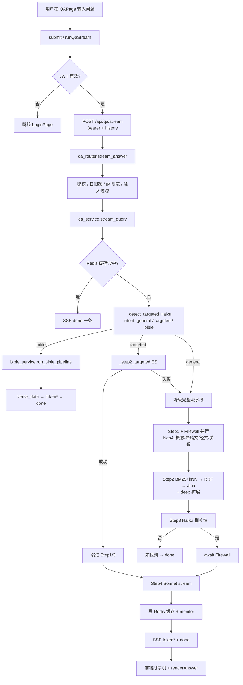

# QA 问答站：从「用户提交问题」到「答案展示」调用链

> 只读勘探。范围：`front_qa`、`back_qa`，以及被它们调用的 `back_shared` / `back_mic/backend/kg_rag.firewall`。  
> 结论均附 `文件:行号`；无行号依据的列入第 5 节。  
> 勘探日期：2026-11-09。未启动服务、未读生产 `.env` 实值、未查库内容。

---

## 1. 入口

| 角色 | 位置 | 依据 |
|------|------|------|
| 主前端 | `QAPage.vue` 的 `submit()` → `runQaStream()`，`POST /api/qa/stream` | `front_qa/src/components/QAPage.vue:1323`、`1415`、`1494-1506` |
| 开发调试 | `DebugPanel.vue` 的 `submit()`，`POST /api/qa/query`（非流式） | `front_qa/src/components/DebugPanel.vue:163-171` |
| 路由首页 | `/` → `QAPage` | `front_qa/src/router/index.js:9-12` |
| 本地代理 | Vite 把 `/api/qa` 转到 `http://localhost:8001` | `front_qa/vite.config.js:15-18` |
| 后端挂载 | `qa_router` / `bible_router` 前缀 `/api/qa`；`auth_router` 自带完整路径 | `back_qa/main.py:108-110` |
| 接收路由 | `stream_answer` → `/api/qa/stream`；`query` → `/api/qa/query` | `back_qa/qa/qa_router.py:265-301`、`239-262` |

页面展示：流式 `token` / `done` 写入 `msg.answer`，模板用 `renderAnswer(displayAnswer(msg))`；经文意图另渲染 `BibleMessage`（`QAPage.vue:93-117`、`821-851`、`1548-1642`）。

---

## 2. 调用链

按主路径 `/api/qa/stream`，格式：**步骤名｜文件:行号｜函数名｜一句话作用｜外部资源**。

1. 前端提交｜`QAPage.vue:1323`｜`submit`｜校验登录、拼追问、推气泡｜无  
2. 流式请求｜`QAPage.vue:1465`、`1494`｜`runQaStream`｜`authFetch` 发 SSE｜无  
3. 带 Token 请求｜`auth.js:70`｜`authFetch`｜附 JWT，401 清登录｜无  
4. 路由入口｜`qa_router.py:265`｜`stream_answer`｜鉴权、日限额、限流、注入检测｜SQLite（用量）、Redis（限流）  
5. 日限额｜`auth.py:97`｜`check_and_increment_daily_usage`｜超限 429｜SQLite `qa_users.db`（`auth.py:15`）  
6. IP 限流｜`rate_limit.py:26`｜`check_rate_limit`｜超限 429；无 Redis 放行｜Redis `qa:ratelimit:*`  
7. 流式编排｜`qa_service.py:1681`｜`stream_query`｜跑到 Step4 前再流式生成｜见下  
8. 公共前半段｜`qa_service.py:1203`｜`_run_pipeline_until_step4`｜缓存 / 意图 / Step1–3｜见下  

### `_run_pipeline_until_step4` 内部

9. 缓存键｜`qa_service.py:235`｜`_make_cache_key`｜问题+历史+版本哈希｜`version_manifest.py`；Redis 前缀 `qa:cache:`  
10. 读缓存｜`qa_service.py:1225-1237`｜`_read_cache`｜命中则 early `done`｜Redis  
11. 意图预判｜`qa_service.py:1251-1264`｜`_detect_targeted`｜bible / targeted / general｜大模型 `claude-haiku-4-5-20251001`（`STEP3_MODEL`，`qa_service.py:105`）  
12a. **bible** → 返回 `bible_ctx`，见步骤 20  
12b. **targeted**｜`qa_service.py:1282-1298`｜`_step2_targeted`｜书+篇精确取段；失败降级｜ES `kg-rag_*`（`qa_service.py:769-776`）  
12c. **完整流水线并行**｜`qa_service.py:1300-1302`｜`_step1` + `_run_firewall`｜概念与防火墙｜Neo4j；防火墙见 14  
13. Step1｜`qa_service.py:497`｜`_step1`｜抽 surface/deep、改写 query、希腊文/经文/关系｜默认 `claude-sonnet-4-6`（`STEP1_MODEL`，`104`）；Neo4j（`neo4j_client.py:84+`）  
14. Firewall｜`qa_service.py:354`｜`_run_firewall`｜匹配防火墙标题注入 Step4｜`kg_rag.firewall`（`firewall.py:1+`）；匹配模型 `claude-sonnet-4-6`（`firewall.py:39`）  
15. Step2｜`qa_service.py:703`｜`_step2_with_expansion`｜主路+deep 扩展检索｜ES 默认 `QA_ES_INDEX` / `kg-rag_7feasts,kg-rag_bib,...`（`qa_service.py:115-117`）  
16. 检索细节｜`retrieval.py:13`、`67`、`129`、`174`｜`bm25_search` / `dense_search` / `rrf_merge` / `rerank`｜BM25+kNN→RRF→精排｜ES；Embedding `qwen/qwen3-embedding-8b`（`embedding_adapter.py:14`）；Rerank `jina-reranker-v3`（`reranker_service.py:14`）  
17. Step3｜`qa_service.py:941`｜`_step3`｜相关性；否 → 固定「未找到」并缓存｜`claude-haiku-4-5-20251001`  
18. 组装 ctx｜`qa_service.py:1387-1411`｜（内联）｜准备 Step4 材料｜无  

### 回到 `stream_query`

19. Step 进度事件｜`qa_service.py:1791-1804`｜yield `type=step`｜主前端未消费 step（只处理 token/done/verse_data/error）｜无  
20. **bible**：`verse_data` + `run_bible_pipeline`｜`qa_service.py:1719-1770`；`bible_service.py:259`｜经文 JSON + 改写→Step1→Step2→流式答｜圣经内存 JSON；Neo4j；ES；Claude Step4 `claude-sonnet-4-6`  
21. **普通**：流式 Step4｜`qa_service.py:1414`、`1822`｜`_iter_step4_stream_tokens`｜逐 token｜`claude-sonnet-4-6`（`STEP4_MODEL`，`106`）  
22. 写缓存/监控｜`qa_service.py:1869-1878`｜`_write_cache` / `_write_monitor`｜非 debug 写答案缓存｜Redis  
23. SSE `done`｜`qa_service.py:1880`｜yield done｜found/sources/elapsed/cost｜无  
24. 前端打字机｜`QAPage.vue:1566-1642`｜token→队列；done 定稿｜答案/书目/经文组件｜无  

非流式孪生：`run_pipeline`（`qa_service.py:1448`）前半相同，Step4 走阻塞 `_step4`（`1166`）。

---

## 3. 分支

| 条件 | 路径 | 依据 |
|------|------|------|
| 未登录 / Token 过期 | 前端不发或 `AuthExpiredError` 清气泡跳登录 | `QAPage.vue:1326-1328`、`1654-1660`；`auth.js:59-67` |
| 日问答超限 | `/stream` 429；前端警告并写进气泡 | `qa_router.py:272-277`；`QAPage.vue:1509-1520`、`1661-1674` |
| IP 限流 | 429「请求过于频繁」 | `qa_router.py:278-279`；`rate_limit.py:26-33` |
| 注入检测失败 | 400 | `qa_router.py:280-281` |
| Redis 缓存命中且未 `skip_cache` | 跳过流水线，仅一条 `done`（`cache_hit=true`） | `qa_service.py:1225-1237`、`1704-1717` |
| `QA_SKIP_TARGETED=1` | 不做意图预判 | `qa_service.py:1251-1252` |
| 意图 `bible` | `verse_data` + `run_bible_pipeline` | `qa_service.py:1257-1264`、`1719-1770` |
| 意图 `targeted` 且 ES 有段 | 跳过 Step1/3；定向 ES | `qa_service.py:1282-1292`、`1331-1334` |
| targeted 无结果/异常 | 降级完整流水线 | `qa_service.py:1293-1298` |
| Step1 LLM 失败 | 空概念，`rewritten_query=原问题` | `qa_service.py:543-552` |
| Step2 异常 | `passages=[]` 继续 Step3 | `qa_service.py:1327-1329` |
| 空检索结果 | 仍进 Step3（prompt 为「（无检索结果）」）；是否「未找到」由 LLM 判定 | `qa_service.py:954`、`1336` |
| Reranker 失败 | 保持 RRF 原序截断 | `retrieval.py:191-198`；`reranker_service.py:59-60` |
| Embedding/BM25/kNN 失败 | 该路返回 `[]` | `retrieval.py:53-55`、`87-89`、`115-117` |
| Firewall 加载/执行失败 | `firewall_doc=None`，静默继续 | `qa_service.py:346-365` |
| Step3 `relevant=False` | 固定未找到文案；可写缓存；流式直接 `done` | `qa_service.py:1339-1381`；前端 `QAPage.vue:88-90` |
| Step3 LLM/JSON 失败 | 默认 `relevant=True` | `qa_service.py:964-972` |
| Step4 流失败 | yield `error` | `qa_service.py:1823-1825` |
| 整请求超时 | 中间件 120s → 504 | `main.py:85-97` |
| Redis 不可用 | 缓存关、限流放行 | `dependencies.py:40-42`；`rate_limit.py:32-33` |
| 前端追问补全书名 | 改 `finalQuestion` 再请求 | `QAPage.vue:1389-1409` |

---

## 4. 命名（分站点）

### QA 站（`front_qa` / `back_qa`）

| 称呼 | 出现位置 |
|------|----------|
| **职事信息问答** | `main.py:2,82`；`QAPage.vue:7`；`LoginPage.vue:4`；`index.html:13`；`style/index.css:1`；Step4 system（`qa_service.py:1196,1419`） |
| **四步流水线** | `qa_service.py:3,1457` |
| **PanAI**（共享 `.env`/共存部署，非流程产品名） | `main.py:10`；`DEPLOY.md` |
| **kg-rag_***（ES 索引名） | `qa_service.py:117,770-776` |
| **kg_rag.firewall**（复用主站模块） | `qa_service.py:330,340,343` |
| 文档侧「3.0 问答」 | `qa4/README.md`（运行时**无** `3.0` 模式字符串） |
| 页面「职事信息」检索文案 | `QAPage.vue:90,302,718`；`BibleMessage.vue:545` |

QA 站应用代码中**未**把本聊天流程标成运行时模式「3.0 / 3.5 / KG-RAG」；`KG-RAG` 主要体现在索引名与复用的 `kg_rag.firewall`。文件中出现的 `3.0` 也可能是定价数字（`qa_service.py:214`）或依赖版本，勿与产品模式混淆。

### 主站（`front_mic` / `back_mic`）— 另一套工具台，非本 QA 聊天

| 称呼 / 入口 | 位置 |
|-------------|------|
| **KG-RAG** 测试台 → `/api/kg_rag/query` | `KgRagTest.vue`；后端 `main.py:426` 挂 `kg_rag_router`；默认 mode 可见 `kg_rag_router` |
| **PanAI 新测试台 / 原 3.5** → `/api/t35test/query` | `Panai35Test.vue:1,2006`；`main.py:427` 称拆到 `main_t35test.py` |
| **PanAI2 / PanAI3** → `/api/panai2/query` | `PanAI2Test.vue`；`PanAI3Test.vue` |
| **2.0 / 3.0 / 3.5** 大纲模式 | `Search.vue`、`KgRagTest.vue`（大纲 KG-RAG，非 QA 站 SSE 聊天） |

与 QA 站是不同前端、不同 API 前缀。QA 默认端口 **8001**（`main.py:115`）；主站注释里 t35test 亦提 8001——**生产是否同机同端口未在本仓库运行配置中确认**。

---

## 5. 未能确认

1. 生产 Nginx/反代如何把 `front_qa` 的 `/api/qa` 指到 `back_qa`（本地仅见 `vite.config.js:15-18`）。  
2. 经文问答写入的 Redis 缓存（`answer: ""`，`qa_service.py:1741-1752`）再次命中 early `done` 时，前端是否缺 `verse_data`、气泡是否空白——未见专门前端分支。  
3. `Step1` 返回里的 `targeted` 字段（`qa_service.py:569-578`）在 `_run_pipeline_until_step4` 中**未被使用**；实际定向只靠 `_detect_targeted`——是否历史残留未在注释中说明。  
4. 环境变量覆盖后的真实模型/索引（`QA_STEP1_MODEL`、`QA_ES_INDEX`、`EMBEDDING_KG_MODEL` 等）以部署 `.env` 为准，仓库内只有默认值。  
5. `front_cn` 亦有调 `/api/qa/stream` 的页面（可能是分支拷贝），**不在本次 QA 站主链范围**。  
6. Step3 在空 `passages` 时生产上是否稳定返回 `relevant=False`——代码始终调用 Step3，结果依赖 LLM。

---

## 6. 流程图（总览）

---

## 7. 引用文件与行数

| 文件路径 | 总行数 |
|----------|--------|
| `front_qa/src/components/QAPage.vue` | 2448 |
| `front_qa/src/components/DebugPanel.vue` | 337 |
| `front_qa/src/components/BibleMessage.vue` | 1010 |
| `front_qa/src/components/LoginPage.vue` | 163 |
| `front_qa/src/utils/auth.js` | 106 |
| `front_qa/src/router/index.js` | 55 |
| `front_qa/vite.config.js` | 21 |
| `front_qa/index.html` | 19 |
| `front_qa/src/style/index.css` | 38 |
| `back_qa/main.py` | 116 |
| `back_qa/DEPLOY.md` | 251 |
| `back_qa/qa/qa_router.py` | 685 |
| `back_qa/qa/qa_service.py` | 1891 |
| `back_qa/qa/bible_service.py` | 371 |
| `back_qa/qa/bible_router.py` | 108 |
| `back_qa/qa/dependencies.py` | 42 |
| `back_qa/qa/auth.py` | 328 |
| `back_qa/qa/auth_router.py` | 168 |
| `back_qa/qa/rate_limit.py` | 97 |
| `back_qa/qa/prompts.py` | 418 |
| `back_qa/qa/translation_service.py` | 282 |
| `back_shared/retrieval.py` | 205 |
| `back_shared/embedding_adapter.py` | 53 |
| `back_shared/reranker_service.py` | 111 |
| `back_shared/neo4j_client.py` | 223 |
| `back_shared/version_manifest.py` | 15 |
| `back_mic/backend/kg_rag/firewall.py` | 214 |
| `back_mic/backend/main.py` | 440 |
| `front_mic/frontend/src/components/toolbox/KgRagTest.vue` | 3512 |
| `front_mic/frontend/src/components/toolbox/Panai35Test.vue` | 4449 |
| `front_mic/frontend/src/components/toolbox/PanAI3Test.vue` | 853 |
| `front_mic/frontend/src/components/toolbox/PanAI2Test.vue` | 551 |

行数以 2026-11-09 本机统计为准；之后若改文件会漂移。

---

## 相关文档

- 更早的摸底（含相近内容）：[`qa_site_flow.md`](./qa_site_flow.md)（2026-11-08）
