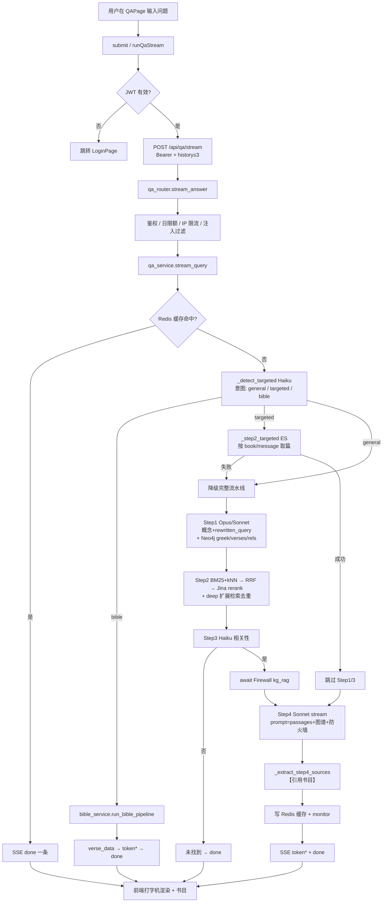

# QA 问答站（back_qa + front_qa）运行流程摸底

> 只读调查报告。结论均附证据路径；未能从代码确认处列入第 6 节。  
> 调查日期：2026-11-08。未启动服务、未读 `.env` 值、未查库内容。

---

## 1. 一页总览

前端主路径走 **`POST /api/qa/stream`（SSE）**；调试面板可走非流式 `POST /api/qa/query`。



ASCII 简版：

```
QAPage.submit
  → authFetch POST /api/qa/stream
    → stream_answer（鉴权/限额/限流）
      → stream_query
          ├ cache hit → done
          ├ intent=bible → verse_data + bible pipeline → done
          ├ intent=targeted → ES 定向段落 → Step4
          └ general → Step1(Neo4j) → Step2(ES) → Step3 → Firewall → Step4
      → SSE token / done
  → 打字机展示答案 + sources；可选反馈 / 翻译 / TTS
```

---

## 2. A–F 逐项说明

### A. 入口与结构

#### A.1 目录结构

**back_qa/**

| 路径 | 用途 |
|------|------|
| `back_qa/main.py` | FastAPI 入口，端口默认 8001 |
| `back_qa/qa/` | 路由、流水线、鉴权、圣经、ASR、限流 |
| `back_qa/bible_data/*.json` | 圣经 JSON（启动加载进内存） |
| `back_qa/asr_corrections.json` | ASR 纠错表 |
| `back_qa/scripts/` | e2e / 限流 / 答案测试脚本 |
| `back_qa/DEPLOY.md` | 部署说明 |
| `back_qa/requirements.txt` | 额外依赖说明 |

**front_qa/**

| 路径 | 用途 |
|------|------|
| `front_qa/src/main.js` | Vue 入口 |
| `front_qa/src/router/index.js` | hash 路由 |
| `front_qa/src/components/QAPage.vue` | 主问答页（流式） |
| `front_qa/src/components/LoginPage.vue` | 登录/注册 |
| `front_qa/src/components/AdminPage.vue` | 管理后台 |
| `front_qa/src/components/DebugPanel.vue` | 非流式 `/query` 调试 |
| `front_qa/src/components/BibleMessage.vue` | 经文展示 |
| `front_qa/src/utils/auth.js` | JWT / authFetch |
| `front_qa/vite.config.js` | 开发端口 5174，代理 `/api/qa` → 8001 |
| `front_qa/public/` | `lsm_mapping.json`、`polly_replacement_map.json` |

#### A.2 后端启动与端口

- 入口：`back_qa.main:app`（`back_qa/main.py` L82、L113–116）。
- 默认端口：环境变量 `QA_PORT`，默认 `"8001"`（`main.py` L115）。
- 本地：`uvicorn.run("back_qa.main:app", host="0.0.0.0", port=port, reload=True)`。
- 部署：`DEPLOY.md` 写明 `python -m uvicorn back_qa.main:app --host 0.0.0.0 --port 8001`。
- 启动 lifespan：`init_db()`、加载 `bible_data`、`Neo4jClient.startup()`、每 5 分钟刷新 baseline（`main.py` L36–56）。
- `.env` 加载路径：`back_mic/backend/.env`（只确认路径名，未读内容；`main.py` L10–18）。
- 单请求超时中间件：120 秒 → 504（`main.py` L85–97）。

#### A.3 前端路由

证据：`front_qa/src/router/index.js`。

| path | 组件 | 鉴权 |
|------|------|------|
| `/login` | LoginPage | 公开 |
| `/` | QAPage | 需 JWT 且未过期 |
| `/admin` | AdminPage | 本地有 token 即放行（不过期校验） |
| `/debug` | redirect → `/admin` | — |

History：`createWebHashHistory()`。开发代理：`/api/qa` → `http://localhost:8001`（`vite.config.js` L12–19）。

#### A.4 全部接口

前缀说明：`qa_router` / `bible_router` 挂在 `prefix="/api/qa"`（`main.py` L108–109）；`auth_router` 无 prefix，路径自带 `/api/qa/auth/...`（`main.py` L110；`auth_router.py`）。

| # | 方法 | 路径 | 流式 | 请求要点 | 响应要点 | 证据 |
|---|------|------|------|----------|----------|------|
| 1 | GET | `/api/qa/liveness` | 否 | — | `{status:"ok"}` | `qa_router.py` L185–188 |
| 2 | GET | `/api/qa/readiness` | 否 | — | neo4j/es/redis 状态 + data_baseline | L191–236 |
| 3 | POST | `/api/qa/query` | 否 | `QueryRequest`：question≤500、skip_cache、debug、params、history | `QueryResponse`：request_id/answer/sources/concepts/found/cache_hit/elapsed/cost/… | L239–262；模型 L47–77 |
| 4 | POST | `/api/qa/stream` | **是 SSE** | 同 QueryRequest | 事件 JSON：`type=step\|token\|done\|error\|verse_data` | L265–301 |
| 5 | POST | `/api/qa/translate` | 否 | text、sources、target_lang∈{zh_tw,en}、question、cache_key | `{answer, sources}` | L304–330 |
| 6 | POST | `/api/qa/tts` | 流式 audio/wav | text、lang∈{zh,zh_tw,en} | WAV 流 | L333–421 |
| 7 | POST | `/api/qa/tts/minimax` | 流式 audio/mpeg | 同 TTSRequest | MP3 流 | L424–484 |
| 8 | POST | `/api/qa/tts/elevenlabs` | 否 | 同 TTSRequest | audio/mpeg 整段 | L487–532 |
| 9 | POST | `/api/qa/feedback` | 否 | request_id、question、answer、rating∈{1,-1} | `{ok:true}` | L535–551 |
| 10 | POST | `/api/qa/cache/clear` | 否 | Header `X-Admin-Token` | `{deleted, prefix}` | L573–587 |
| 11 | POST | `/api/qa/stats/clear` | 否 | Admin | `{deleted, key}` | L590–599 |
| 12 | GET | `/api/qa/stats` | 否 | Admin | 用量汇总 + step_fail_records | L602–641 |
| 13 | GET | `/api/qa/feedback/stats` | 否 | Admin | thumbs_up/down/rate/recent_down | L644–649 |
| 14 | POST | `/api/qa/asr` | 否 | multipart file + Bearer | `{text}` | L652–685 |
| 15 | POST | `/api/qa/bible/query` | **是 SSE** | book/chapter/verse 或 question；history | 事件包在 `{event,data}` | `bible_router.py` L42–108 |
| 16 | POST | `/api/qa/auth/register` | 否 | invite_code、username、password | `{ok:true}` | `auth_router.py` L87–94 |
| 17 | POST | `/api/qa/auth/login` | 否 | username、password | `{token, username}` | L97–103 |
| 18 | GET | `/api/qa/auth/me` | 否 | Bearer | `{username}` | L106–110 |
| 19 | GET | `/api/qa/auth/usage` | 否 | Bearer | `{used, limit}` | L113–117 |
| 20 | POST | `/api/qa/auth/invite` | 否 | Admin + `{code}` | `{ok, code}` | L120–126 |
| 21 | GET | `/api/qa/auth/users` | 否 | Admin | `{items:[…]}` | L129–133 |
| 22 | DELETE | `/api/qa/auth/users/{username}` | 否 | Admin | `{ok:true}` | L136–144 |
| 23 | GET | `/api/qa/auth/invites` | 否 | Admin | `{items:[…]}` | L147–151 |
| 24 | POST | `/api/qa/auth/users/{username}/limit` | 否 | Admin + `{daily_limit}` | `{ok, username, daily_limit}` | L158–167 |

**主前端实际调用**：`/stream`、`/feedback`、`/translate`、`/tts*`、`/asr`、`/auth/login|register|usage`；Admin：`/stats`、`/cache/clear`、`/feedback/stats`、auth 管理；DebugPanel：`/query`。`/bible/query` 在代码中存在，**主 QAPage 未直接调用**（经文走 `/stream` 内 bible 分支）。证据：`QAPage.vue` L1494；`Grep` front_qa。

**SSE done 字段（普通问答）**：`type, answer, sources, found, cache_hit, concepts, elapsed_ms, cost, request_id, cache_key`（`qa_service.py` L1880–1891）。经文另有 `verse_data`（L1730）。

---

### B. 一次提问全链路（主路径：前端 → `/stream`）

#### B.1 前端发请求

1. `QAPage.submit`（`QAPage.vue` L1323）：校验 token，推入 user/assistant 消息。
2. 可选追问补全书名（L1389–1409）。
3. `runQaStream` → `authFetch('/api/qa/stream', POST)`（L1493–1505），body：`question, skip_cache:false, debug:false, history`（最近对话，前端 `history` 最多保留 3 轮，L1701–1705）。
4. `navigator.locks.request('qa-stream', …)` 串行化本页流式请求（L1493）。
5. 解析 SSE `data:` JSON；`token` 打字机；`done` 填 sources/concepts/cache 等（L1548–1642）。

#### B.2 接口层

`qa_router.stream_answer`（L265–301）：

1. `_require_user` → JWT（`auth_router._require_user`）。
2. `check_and_increment_daily_usage(username)`（SQLite 日限额）。
3. `check_rate_limit`（Redis IP 滑动窗口）。
4. `check_prompt_injection`。
5. `_resolve_request_id`（`X-Request-ID` 或新 UUID）。
6. `EventSourceResponse` 包装 `stream_query(...)`。

#### B.3 问题处理（改写 / 分类 / 意图）

均在 `_run_pipeline_until_step4`（`qa_service.py` L1203+）：

| 步骤 | 函数 | 模型 | 作用 |
|------|------|------|------|
| 意图预判 | `_detect_targeted` L372 | `STEP3_MODEL` = `claude-haiku-4-5-20251001` | general / targeted / bible；模板 `TARGETED_DETECTION`（`prompts.py` L160） |
| 概念+改写 | `_step1` L497 | `QA_STEP1_MODEL` 默认 `claude-sonnet-4-6` | surface/deep/concepts、`rewritten_query`；模板 `STEP1_CONCEPT_EXTRACTION` |
| Firewall | `_run_firewall` L354 | 经 `kg_rag.firewall.match_firewall`，匹配模型 `claude-sonnet-4-6`（`firewall.py` L39） | 与 Step1 并发；Step3 通过后 await |

- 定向命中且 ES 有结果：跳过 Step1/Firewall/Step3（L1282–1334）。
- `QA_SKIP_TARGETED=1` 可跳过意图预判（L1251–1254）。
- 历史：Step1 注入最近 3 轮**问题**（L514–522）；Step4 注入最近 3 轮问答（`_build_history_context` L979）。

#### B.4 检索（ES）

索引来源：`QA_ES_INDEX`，默认（`qa_service.py` L115–118）：

`kg-rag_7feasts,kg-rag_bib,kg-rag_cwwl,kg-rag_cwwn,kg-rag_life,kg-rag_map_note,kg-rag_others`

实现：`back_shared/retrieval.py`，由 `_step2` / `_step2_with_expansion` 调用。

| 项 | 值 | 证据 |
|----|-----|------|
| BM25 | `match` on `text`，analyzer `ik_smart`；默认 top_k=30 | `retrieval.py` L29–36；`qa_service.py` L109 |
| Dense / kNN | field `embedding`；query 经 `get_embedding`；k=top_k，num_candidates=100；默认 top_k=30 | `retrieval.py` L67–97；`embedding_adapter.py` |
| 融合 | RRF，k=60，双路权重 1.0 | `retrieval.py` L129–171；`RRF_K=60` |
| 重排 | Jina `jina-reranker-v3`；默认 top_n=20；失败降级原序 | `reranker_service.py`；`_step2` L697 |
| 扩展路 | 每个 deep 概念：`rewritten_query + concept`，BM25/Dense top15，rerank top5；按 `chunk_id` 去重后追加 | `_step2_with_expansion` L703–765 |
| 定向 | `_step2_targeted`：book_title match → 聚合 message_key → term 取段，上限 50；索引集合 `_TARGETED_SUPPORTED_INDICES`（均为 `kg-rag_*`） | L768–934 |

**未发现** 代码中使用 `panai4_*` 索引（仅 `kg-rag_*`）。

Embedding：OpenRouter `EMBEDDING_KG_MODEL` 默认 `qwen/qwen3-embedding-8b`，维数 `EMBEDDING_KG_DIMS` 默认 1024（`embedding_adapter.py` L12–15）。

#### B.5 图谱（Neo4j）

- 客户端：`back_shared.neo4j_client.Neo4jClient`（`dependencies.get_neo4j_client`）。
- 连接变量：`NEO4J_URI`、`NEO4J_USER`、`NEO4J_PASSWORD`（`neo4j_client.py` L6–8、L20–22）。
- **数据库名**：代码未传 `database=`，使用驱动默认库；具体库名 **未能确认**（无 `NEO4J_DATABASE` 引用）。
- 查询（均在 Step1 成功抽概念后）：
  1. `get_concept_names`：`MATCH (c:Concept) RETURN c.name`（启动加载）
  2. `get_greek_terms`：Concept.greek_terms
  3. `get_key_verses`：`(c)-[:SUPPORTED_BY]->(s:Scripture)`，每概念最多 3 节写入 prompt（`qa_service.py` L626）
  4. `get_concept_relations`：概念间直接关系，标签映射 CONTAINS/OPPOSES/…
  5. `get_baseline`：readiness 用

图谱结果注入 Step4 的 `greek_context` / `verse_context` / `graph_context`，**不替代 ES 检索**。

#### B.6 Prompt 组装

模板文件：`back_qa/qa/prompts.py`。

| 阶段 | 模板常量 | 放入内容 | 长度相关上限（代码可见） |
|------|----------|----------|--------------------------|
| 意图 | `TARGETED_DETECTION` | question | 输出 max_tokens=256 |
| Step1 | `STEP1_CONCEPT_EXTRACTION` | question、concept_list、history_questions | rewritten_query 提示 10–30 字；输出 max_tokens=512；surface≤3 deep≤5 |
| Step3 | `STEP3_RELEVANCE_CHECK` | rewritten_query、passages | 最多 10 段，每段 text 截断 200 字（`_step3` L948–953）；max_tokens=512 |
| Step4 | `STEP4_ANSWER_GENERATION` | history_context、question、passages（全文+source_zh）、greek/verse/graph、firewall_instruction | 输出 max_tokens=4096；**未见 prompt 总长硬截断** |
| 圣经 Step4 | `BIBLE_STEP4_ANSWER_GENERATION` | ref_gb、text_gb_plain、改写问题、passages… | 同 Step4 max_tokens=4096 |

组装函数：`_step4_build_prompt`（`qa_service.py` L1007–1050）。段落头：`[来源：{source_zh_clean or book_title}]`。

版本常量：`back_shared/version_manifest.py`（`PROMPT_VERSION`、`MODEL_PROFILE`、`FIREWALL_RULES_VERSION`）参与缓存 key。

#### B.7 调模型

| 用途 | 模型常量 | 关键参数 | 证据 |
|------|----------|----------|------|
| 意图预判 | `claude-haiku-4-5-20251001` | temp=0, max_tokens=256 | `_detect_targeted` |
| Step1 | `QA_STEP1_MODEL` 默认 `claude-sonnet-4-6` | temp=0, max_tokens=512 | L104, L536–540 |
| Firewall 匹配 | `claude-sonnet-4-6` | temp=0, max_tokens=100 | `kg_rag/firewall.py` L39, L166 |
| Step3 | Haiku 同上 | temp=0, max_tokens=512 | `_step3` |
| Step4 | `claude-sonnet-4-6` | temp=0.3, max_tokens=4096 | `_step4` / `_iter_step4_stream_tokens` |
| 密钥 | `CLAUDE_API_KEY` → AsyncAnthropic | — | L133–138 |
| 翻译 EN | `QA_TRANSLATION_GEMINI_MODEL` 默认 `gemini-3.5-flash` | `GEMINI_API_KEY` | `translation_service.py` |
| TTS | Gemini / MiniMax / ElevenLabs | 各自 env | `qa_router.py` |
| ASR | 见 `asr_service.py`（`ANTHROPIC_API_KEY` 或 `CLAUDE_API_KEY`） | — | `asr_service.py` L89 |

#### B.8 后处理（引用 / 出处）

1. 模型被要求在文末输出 `【引用书目】`（`STEP4_ANSWER_GENERATION` 规则 7）。
2. `_extract_step4_sources(raw)`（L1053–1075）：切分书目块，按书名去重，保留编号行。
3. 英文书目：`_match_sources_to_english` 用 passages 的 `source_zh`↔`source_en` 匹配；必要时 `translate_source_zh_to_en`（翻译接口路径）。
4. `found=False` 固定文案：「以下内容未能在职事信息中找到相关依据。」（L1360）。

#### B.9 返回前端并展示

1. 流式：`token` → 打字机；遇到 `【引用书目】` 停止正文打字（`QAPage.vue` L1584–1605）。
2. `done`：写入 answer/sources/concepts/cache_key/request_id/elapsed/cost；`found` 控制展示。
3. `verse_data`：切换 `intent=bible`，由 `BibleMessage` 展示经文，职事答案继续 token。
4. 可选：`/feedback`、`/translate`、TTS、ASR。

**圣经旁路摘要**（`run_bible_pipeline`，`bible_service.py` L259+）：Haiku 改写问题 → `_step1` → `_step2_with_expansion` → `BIBLE_STEP4` 流式；无 Step3/Firewall（`firewall_instruction=""`）。

---

### C. 依赖（back_shared / back_mic / kg_rag）

#### C.1 back_qa 对共享包的 import 与用途

| import | 用途 | 证据 |
|--------|------|------|
| `back_shared.neo4j_client.Neo4jClient` | 图谱客户端 | `dependencies.py` L9 |
| `back_shared.retrieval` | BM25/dense/RRF/rerank | `qa_service.py` L683, L717 |
| `back_shared.version_manifest` | PROMPT_VERSION / MODEL_PROFILE / FIREWALL_RULES_VERSION | `prompts.py` L7；`qa_service.py` L236；`qa_router.py` L195 |
| `back_shared.embedding_adapter` | （经 retrieval）向量 | `retrieval.py` L9 |
| `back_shared.reranker_service` | （经 retrieval）Jina 精排 | `retrieval.py` L10 |
| `kg_rag.firewall.load_firewall / match_firewall` | 防火墙；通过把 `back_mic/backend` 插入 `sys.path` | `qa_service.py` L329–345 |
| （间接）`back_mic/backend/.env` | dotenv 加载，不 import 包本身 | `main.py` L10–18 |
| （间接）`firewall.json` / `firewall_rules.json` | firewall 数据文件 | `kg_rag/firewall.py` L16–17 |

**未发现** `back_qa` 直接 import `kg_rag.kg_rag_service` 或 `kg_rag.prompts`（仅 firewall）。

#### C.2 配置变量名（只列名，不含值）

**ES**：`ES_HOST`、`ES_PORT`、`ES_USERNAME`、`ES_PASSWORD`；业务索引 `QA_ES_INDEX`。

**Neo4j**：`NEO4J_URI`、`NEO4J_USER`、`NEO4J_PASSWORD`。

**Redis**：`REDIS_HOST`、`REDIS_PORT`、`REDIS_DB`；`QA_REDIS_PREFIX`、`QA_CACHE_TTL`、`QA_MONITOR_KEY`、`QA_RATELIMIT_PREFIX`、`QA_RATE_LIMIT_PER_MINUTE`。

**LLM / 其它**：`CLAUDE_API_KEY`、`QA_STEP1_MODEL`、`QA_STEP3_MODEL`、`QA_SKIP_TARGETED`、`QA_PORT`、`QA_ADMIN_TOKEN`、`QA_JWT_SECRET`、`QA_DAILY_LIMIT`（模块内有读取；日限额实际以 SQLite `users.daily_limit` 为准，见 auth）、`OPENROUTER_API_KEY`、`OPENROUTER_BASE_URL`、`EMBEDDING_KG_MODEL`、`EMBEDDING_KG_DIMS`、`JINA_API_KEY`、`GEMINI_API_KEY`、`QA_TRANSLATION_GEMINI_MODEL`、`MINIMAX_API_KEY`、`MINIMAX_GROUP_ID`、`ELEVENLABS_API_KEY`、`ELEVENLABS_VOICE_ZH`、`ELEVENLABS_MODEL`、`ANTHROPIC_API_KEY`（ASR 备选）。

---

### D. 数据来源

| 来源 | 名称/路径 | 系列 |
|------|-----------|------|
| ES 索引 | `kg-rag_7feasts`、`kg-rag_bib`、`kg-rag_cwwl`、`kg-rag_cwwn`、`kg-rag_life`、`kg-rag_map_note`、`kg-rag_others`（可被 `QA_ES_INDEX` 覆盖） | **3.x kg-rag_***，非 panai4_* |
| Neo4j | 默认 bolt 连接上的 Concept / Scripture 图 | 库名未能确认 |
| 圣经 JSON | `back_qa/bible_data/*.json` | 本地文件 |
| Firewall | `back_mic/backend/firewall.json`、`firewall_rules.json` | 本地文件 |
| 繁体术语表 | `shared/zh_tw_terms.json` | 本地文件（`translation_service.py` L22） |
| ASR 纠错 | `back_qa/asr_corrections.json` | 本地文件 |
| 前端静态 | `front_qa/public/lsm_mapping.json`、`polly_replacement_map.json` | 本地文件 |

---

### E. 记录与反馈

| 类型 | 位置 | 结构（只列结构） | 证据 |
|------|------|------------------|------|
| 用户账号 | SQLite `back_qa/qa/qa_users.db` 表 `users` | id, username, hashed_password, created_at, daily_count, daily_date, daily_limit | `auth.py` L15, L45–94 |
| 邀请码 | 同库 `invite_codes` | id, code, used, used_by, created_at | L55–62 |
| 用户反馈 | 同库 `feedback` | id, request_id, username, question, answer, rating, created_at | L66–75；写入 `insert_feedback` |
| 请求监控 | Redis List `QA_MONITOR_KEY` 默认 `qa:monitor:records`，最多 5000 | JSON：request_id, question, cache_hit, found, total_elapsed_ms, total_cost_usd, step_fail_stage?, ts | `qa_service.py` L272–285 |
| 答案缓存 | Redis `QA_REDIS_PREFIX`+sha256 | 完整结果 JSON（含 passages） | `_make_cache_key` / `_write_cache` |
| 前端对话历史 | 浏览器内存 `history`（最多 3 轮） | `{question, answer}` | `QAPage.vue` L1701–1705 |
| 进程日志 | 部署写 `/opt/pansearch/logs/qa_backend.log`（DEPLOY）；本地 logging `"qa"` | — | `DEPLOY.md`；`logger = logging.getLogger("qa")` |

**未发现** 独立「全部提问归档」业务表（除 feedback 与 Redis monitor）。

---

### F. 缓存 / 限流 / 鉴权 / 并发

| 机制 | 方式 | 证据 |
|------|------|------|
| 缓存 | Redis；key=sha256(question\|history\|PROMPT_VERSION\|MODEL_PROFILE\|FIREWALL_RULES_VERSION)；TTL `QA_CACHE_TTL` 默认 259200；`skip_cache` / debug 时不写或跳过读 | `qa_service.py` L235–266；L1225–1237；L1564–1565 |
| IP 限流 | Redis sorted set 滑动 60s；默认 15 次/分；无 Redis 则放行 | `rate_limit.py` |
| 日限额 | SQLite `users.daily_limit`；`/stream` 与 `/bible/query` 递增；`/query` **不**递增日限额 | `auth.py` L97–126；`qa_router` stream L272；query L245 仅 `_require_user` |
| 鉴权 | JWT Bearer，`QA_JWT_SECRET`，HS256，7 天；管理接口 `X-Admin-Token`=`QA_ADMIN_TOKEN` | `auth.py`；`auth_router`；`qa_router._check_admin` |
| 注入过滤 | 关键字黑名单 | `rate_limit.check_prompt_injection` |
| 请求超时 | 中间件 120s → 504 | `main.py` TimeoutMiddleware |
| 前端并发 | `navigator.locks('qa-stream')` 单锁；loading 防重复提交 | `QAPage.vue` |
| 后端并发 | 流水线内 asyncio 并发（Step1∥Firewall，BM25∥Dense，扩展检索）；**未见**全局信号量/队列 | `qa_service.py` |
| CORS | `allow_origins=["*"]` | `main.py` L101–106 |

---

## 3. 涉及文件清单

### 后端核心

- `back_qa/main.py`
- `back_qa/qa/qa_router.py`
- `back_qa/qa/qa_service.py`
- `back_qa/qa/prompts.py`
- `back_qa/qa/dependencies.py`
- `back_qa/qa/auth.py`
- `back_qa/qa/auth_router.py`
- `back_qa/qa/bible_router.py`
- `back_qa/qa/bible_service.py`
- `back_qa/qa/bible_ref_parser.py`
- `back_qa/qa/rate_limit.py`
- `back_qa/qa/translation_service.py`
- `back_qa/qa/asr_service.py`
- `back_qa/DEPLOY.md`
- `back_qa/requirements.txt`
- `back_qa/asr_corrections.json`
- `back_qa/bible_data/`（多卷 JSON）

### 共享 / mic

- `back_shared/neo4j_client.py`
- `back_shared/retrieval.py`
- `back_shared/embedding_adapter.py`
- `back_shared/reranker_service.py`
- `back_shared/version_manifest.py`
- `back_mic/backend/kg_rag/firewall.py`
- `back_mic/backend/firewall.json`（firewall 引用路径）
- `back_mic/backend/firewall_rules.json`（firewall 引用路径）
- `shared/zh_tw_terms.json`（翻译引用路径）

### 前端

- `front_qa/vite.config.js`
- `front_qa/package.json`
- `front_qa/src/main.js`
- `front_qa/src/App.vue`
- `front_qa/src/router/index.js`
- `front_qa/src/utils/auth.js`
- `front_qa/src/components/QAPage.vue`
- `front_qa/src/components/LoginPage.vue`
- `front_qa/src/components/AdminPage.vue`
- `front_qa/src/components/DebugPanel.vue`
- `front_qa/src/components/BibleMessage.vue`
- `front_qa/src/style/index.css`
- `front_qa/public/lsm_mapping.json`
- `front_qa/public/polly_replacement_map.json`

---

## 4. 依赖清单（import + 用途）

见 **C.1**。补充内部模块关系：

- `qa_router` → `qa_service.run_pipeline` / `stream_query` / `translate_answer`
- `bible_router` → `bible_service.run_bible_pipeline`
- `bible_service` → 复用 `qa_service._step1` / `_step2_with_expansion` / `_call_llm`
- `main` → 三 router + Neo4j lifespan + bible 加载

第三方（从代码可见）：FastAPI、uvicorn、anthropic、elasticsearch、redis、neo4j、httpx、sse_starlette、jose/jwt、bcrypt、openai（OpenRouter embedding）、OpenCC（翻译）等——完整 pin 以 `back_mic/backend/requirements.txt` + `back_qa/requirements.txt` 为准，本报告未展开版本比对。

---

## 5. 数据来源清单

见 **D**。结论：**现网默认读的是 `kg-rag_*` 索引族，不是 `panai4_*`。**

---

## 6. 未能确认清单

1. Neo4j **具体 database 名**（代码未指定 `database=`，也无 `NEO4J_DATABASE`）。
2. 现网 `.env` 是否覆盖了默认 `QA_ES_INDEX`（只确认变量名，未读值）。
3. `QA_DAILY_LIMIT` 环境变量与 `users.daily_limit` 默认值（建表默认 3）的运营关系：路由里定义了 `DAILY_LIMIT = int(os.getenv("QA_DAILY_LIMIT","30"))`，但 `/stream` 日限检查走的是 `check_and_increment_daily_usage` 的 DB 字段，**该 env 是否被别处用于设默认限额未能从调用链完全确认**（`qa_router.py` L21 定义后未见同文件使用）。
4. 前端是否有生产环境调用 `POST /api/qa/bible/query`（主 QAPage 走 `/stream`；独立路由存在）。
5. Step4 prompt **总字符硬上限**（仅见输出 `max_tokens=4096`，未见输入截断逻辑）。
6. Redis monitor / feedback 的现网数据量与内容（按约束未读）。
7. Embedding / Reranker 现网是否必达（失败时检索/精排会降级为空或原序，属运行时行为）。

---

## 7. 验证

### 7.1 git status

执行：`git status --short`（本摸底完成后实测）：

```
?? docs/panai4_graph/export_pack.md
?? docs/panai4_graph/git_merge_conflict.md
?? docs/panai4_graph/git_merge_resolve.md
?? docs/qa4_survey/
```

说明：

- 本次任务**仅新增** `docs/qa4_survey/`（内含本报告）；无修改任何已跟踪文件。
- `docs/panai4_graph/*` 三份未跟踪文件在摸底开始前已存在（会话初始 `git status` 快照已列出），非本任务写入。

### 7.2 报告内文件路径存在性检查

执行：对第 3 节路径逐一 `Test-Path`（`bible_data` 以目录计）。**全部为 True（40/40）**。明细：

| 路径 | Test-Path |
|------|-----------|
| back_qa/main.py | True |
| back_qa/qa/qa_router.py | True |
| back_qa/qa/qa_service.py | True |
| back_qa/qa/prompts.py | True |
| back_qa/qa/dependencies.py | True |
| back_qa/qa/auth.py | True |
| back_qa/qa/auth_router.py | True |
| back_qa/qa/bible_router.py | True |
| back_qa/qa/bible_service.py | True |
| back_qa/qa/bible_ref_parser.py | True |
| back_qa/qa/rate_limit.py | True |
| back_qa/qa/translation_service.py | True |
| back_qa/qa/asr_service.py | True |
| back_qa/DEPLOY.md | True |
| back_qa/requirements.txt | True |
| back_qa/asr_corrections.json | True |
| back_qa/bible_data | True |
| back_shared/neo4j_client.py | True |
| back_shared/retrieval.py | True |
| back_shared/embedding_adapter.py | True |
| back_shared/reranker_service.py | True |
| back_shared/version_manifest.py | True |
| back_mic/backend/kg_rag/firewall.py | True |
| back_mic/backend/firewall.json | True |
| back_mic/backend/firewall_rules.json | True |
| shared/zh_tw_terms.json | True |
| front_qa/vite.config.js | True |
| front_qa/package.json | True |
| front_qa/src/main.js | True |
| front_qa/src/App.vue | True |
| front_qa/src/router/index.js | True |
| front_qa/src/utils/auth.js | True |
| front_qa/src/components/QAPage.vue | True |
| front_qa/src/components/LoginPage.vue | True |
| front_qa/src/components/AdminPage.vue | True |
| front_qa/src/components/DebugPanel.vue | True |
| front_qa/src/components/BibleMessage.vue | True |
| front_qa/src/style/index.css | True |
| front_qa/public/lsm_mapping.json | True |
| front_qa/public/polly_replacement_map.json | True |

### 7.3 接口总数独立统计

**方法**：对三个 router 文件用正则 `@router\.(get|post|put|delete|patch)\(` 计数（与 A.4 表格独立）。

**命令**：

```powershell
Select-String -Path back_qa/qa/qa_router.py,back_qa/qa/bible_router.py,back_qa/qa/auth_router.py -Pattern '@router\.(get|post|put|delete|patch)\('
```

**实测结果**：

| 文件 | 路由数 |
|------|--------|
| back_qa/qa/qa_router.py | 14 |
| back_qa/qa/bible_router.py | 1 |
| back_qa/qa/auth_router.py | 9 |
| **TOTAL** | **24** |

与 A.4 表格接口数一致：**24**。
